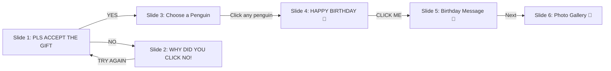

# 🎂 Penguin-Themed Birthday Website

A cute, interactive birthday website with multiple animated slides, penguin characters, a photo gallery, and a heartfelt birthday message.

## Flow Overview

## Proposed Changes

### Single-Page Application (Pure HTML/CSS/JS)

No framework needed — this is a lightweight, single-page interactive experience with smooth CSS transitions between slides.

---

#### [NEW] [index.html](file:///home/kushal_jain/PROJECTS/Birthday_Project/index.html)
Main HTML file with all 6 slides as `<section>` elements:

1. **Slide 1 — Landing**: "PLS ACCEPT THE GIFT" heading, cute penguin SVG (shy/pleading pose), orange YES and NO buttons
2. **Slide 2 — No Response**: "WHY DID YOU CLICK NO!" heading, rolling penguin SVG, orange "TRY AGAIN" button
3. **Slide 3 — Choose Penguin**: "Choose a penguin / Each one has something special to say" heading, 3 penguins holding gift boxes (clickable)
4. **Slide 4 — Happy Birthday**: Celebration scene with "HAPPY BIRTHDAY" title, penguin with party hat + cake, confetti, stars, gifts, duck, "MAKE A WISH" text, "CLICK ME" heart button
5. **Slide 5 — Birthday Message**: Scrapbook-style layout with a heart-shaped photo placeholder, the full custom birthday message, cute stickers/decorations (bunny, duck, cherries), pastel checkered background
6. **Slide 6 — Photo Gallery**: Grid-based gallery with hover effects, ability to easily add more photos by dropping them in a folder

**Design System:**
- Font: Google Fonts — **"Patrick Hand"** for headings (playful handwritten feel) + **"Quicksand"** for body text
- Color palette: Soft pastels — `#fce4ec` (pink), `#fff3e0` (cream), `#e8f5e9` (mint), `#f3e5f5` (lavender), with orange `#ff6b35` accent for buttons
- All penguin characters drawn as inline SVGs for crisp rendering at any size
- Confetti and decorative elements as CSS shapes/SVGs

---

#### [NEW] [style.css](file:///home/kushal_jain/PROJECTS/Birthday_Project/style.css)
Complete stylesheet with:
- CSS custom properties for the design system (colors, fonts, spacing)
- Slide transition system using CSS transforms and opacity with `@starting-style`
- Penguin SVG styling and hover animations (wobble, bounce)
- Button styles with gradient backgrounds and hover/press effects
- Confetti animation using CSS `@keyframes`
- Floating elements animation (stars, hearts)
- Heart-shaped photo frame using `clip-path`
- Gallery grid with responsive layout and hover zoom
- Pastel checkered background pattern for message slide
- Scrapbook decorations positioning
- Mobile responsive breakpoints

---

#### [NEW] [script.js](file:///home/kushal_jain/PROJECTS/Birthday_Project/script.js)
JavaScript for interactivity:
- Slide navigation system (show/hide with smooth transitions)
- YES/NO button click handlers
- Penguin selection handlers (each penguin triggers same celebration slide)
- Confetti particle system on the birthday celebration slide
- "MAKE A WISH" candle blow-out interaction (click to extinguish candle)
- Gallery image lightbox (click to view full-size)
- Background music toggle (optional)

---

#### [NEW] [photos/](file:///home/kushal_jain/PROJECTS/Birthday_Project/photos/)
Directory for gallery photos. You can drop your photos here and they'll appear in the gallery. I'll include a placeholder structure.

---

## Design Details Per Slide

### Slide 1 — "PLS ACCEPT THE GIFT"
- Light cream/white background
- Large bold heading in Patrick Hand font
- Centered cute penguin (shy pose, hands together)
- Two orange pill-shaped buttons: **YES** and **NO**
- Subtle floating hearts in background

### Slide 2 — "WHY DID YOU CLICK NO!"
- Same background
- Penguin in a rolling/tumbling pose (sad/angry)
- Single orange "TRY AGAIN" button
- Penguin wobble animation

### Slide 3 — "Choose a Penguin"
- Pastel background
- "Choose a penguin" in cursive
- "Each one has something special to say" subtitle
- 3 penguins in a row, each holding a pink gift box
- Hover: penguins bounce slightly
- Click: smooth transition to celebration

### Slide 4 — "HAPPY BIRTHDAY"
- Festive background with confetti, stars, streamers
- Large "HAPPY BIRTHDAY" text with rainbow gradient
- Center penguin with party hat holding a cake with candle
- Yellow duck in corner
- Gift boxes in corners
- "MAKE A WISH" text
- Heart-shaped "CLICK ME" button

### Slide 5 — Birthday Message
- Pastel checkered/grid background
- "HAPPY BIRTHDAY" header with decorative elements
- Heart-shaped photo frame (you add your photo)
- The full birthday message in lovely handwriting font
- Cute sticker decorations: bunny, cherries, duck, hearts
- "CLICK ME" arrow to gallery
- "Cutie♡" label under photo

### Slide 6 — Photo Gallery
- Clean masonry/grid layout
- Hover effects on photos (slight zoom + shadow)
- Click to enlarge in lightbox
- Easy to add more photos — just place images in the `photos/` folder and add `` tags

## Open Questions

> [!IMPORTANT]
> **Photo for heart frame**: In Slide 5, there's a heart-shaped photo frame. Do you have a specific photo you want to place there? For now, I'll create a placeholder that you can replace.

> [!IMPORTANT]
> **Gallery photos**: Do you have photos ready to put in the gallery? I'll set up the structure so you can easily drop them in.

> [!NOTE]
> **Background music**: Would you like background music (like a birthday tune) to play when the celebration slide appears? I can add this as an optional toggle.

## Verification Plan

### Manual Verification
- Open the website in a browser and click through all slides
- Test YES → celebration flow
- Test NO → "why did you click no" → TRY AGAIN → back to start
- Test all 3 penguin selections
- Verify birthday message displays correctly with emojis
- Test gallery photo display and hover effects
- Test on mobile viewport sizes
- Verify all animations are smooth
